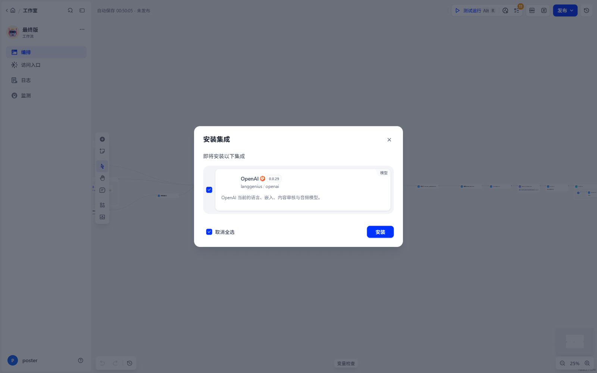
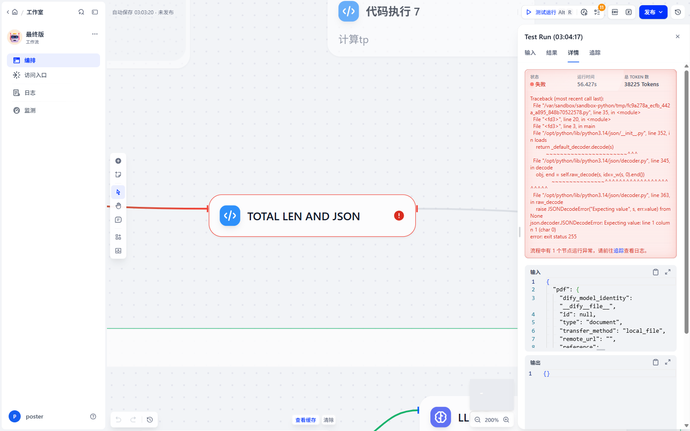
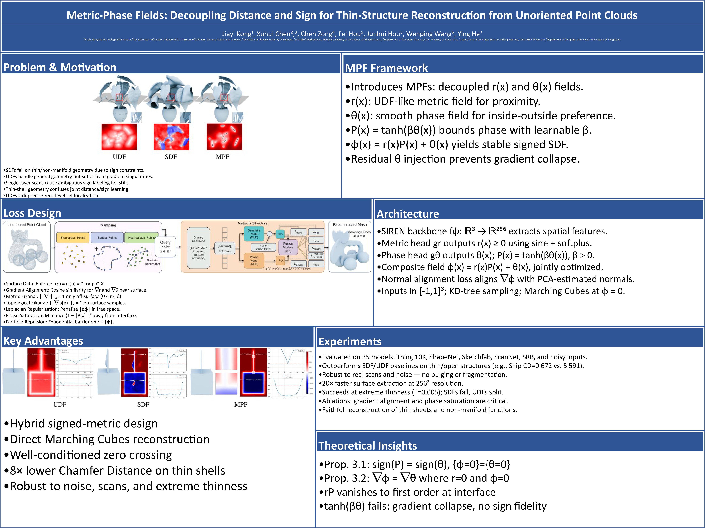

# Paper2Poster × Dify

Turn a research paper PDF into an editable **academic poster** (`.pptx` + high-resolution `.png`)
with a visual [Dify](https://dify.ai) workflow, rebuilt from the
[Paper2Poster](https://github.com/Paper2Poster/Paper2Poster) pipeline.

<p>
  
  
  
  
</p>


<p align="center"><i>A 48×36 in poster produced by the workflow from a real paper
("STREAM3R: Scalable Sequential 3D Reconstruction with Causal Transformer").</i></p>

---

## Demo

**The poster** — 48 × 36 in, produced by one workflow run (~5½ min on a laptop CPU):

[](docs/video/poster-preview.mp4)

**The run** — screen recording of the Dify canvas, upload → parse → outline → layout → render
(3× speed, 1 min 52 s):

[](docs/video/demo.mp4)

| File | What it shows |
|---|---|
| [`docs/video/demo.mp4`](docs/video/demo.mp4) | full workflow run, nodes turning green as each stage completes |
| [`docs/video/poster-preview.mp4`](docs/video/poster-preview.mp4) | 10 s slow zoom over the generated poster |
| [`docs/images/poster.png`](docs/images/poster.png) | the poster itself, 5280 × 3960 |
| `generated_posters/Dify_poster/Dify_poster.pptx` | the editable deck the poster was rendered from |

| Dify canvas | Test run |
|---|---|
|  |  |

### Two papers, same workflow, no per-paper tuning

| «STREAM3R» — 12 sections, 3 figures | «Metric-Phase Fields» — 7 sections, 3 figures |
|---|---|
| [](docs/images/poster.png) | [](docs/images/poster-metric.png) |

---

## Table of contents

- [How it works](#how-it-works)
- [Repository layout](#repository-layout)
- [Quick start](#quick-start)
- [Configuration](#configuration)
- [Known limitations](#known-limitations)
- [Credits](#credits)

---

## How it works

Dify owns the orchestration and all language reasoning; the heavy layout and rendering work stays in
two small Python services beside it, mirroring the original PosterAgent split.

```
                       ┌──────────────────────────── Dify workflow ────────────────────────────┐
 paper.pdf ──upload──▶ │ 1. HTTP  POST /extract_pdf_from_upload/   → markdown + figure list    │
                       │ 2. LLM   split the paper into ≤9 poster sections                       │
                       │ 3. LLM   keep only figures that carry information                      │
                       │ 4. LLM   plan the poster outline (title / sections / emphasis)         │
                       │ 5. HTTP  POST /layout/                    → panel + text + figure boxes│
                       │ 6. LLM   write bullet copy that fits each box                          │
                       │ 7. HTTP  POST /generate_poster/           → .pptx + .png               │
                       └────────────────────────────────────────────────────────────────────────┘
```

* **`local_services/extract_service.py`** (port `44461`) — Docling PDF → Markdown + figure images,
  plus a one-sentence VLM caption per figure. Results are cached by content hash, so re-running the
  workflow on the same PDF is instant.
* **`local_services/poster_service.py`** (port `44462`) — trains the layout regressors on
  `assets/poster_data/Train`, runs `main_inference()` to obtain panel/text/figure boxes, executes the
  generated `python-pptx` code, and renders the deck to PNG.
* **`local_services/render_pptx.py`** — LibreOffice → PDF → PyMuPDF pipeline that works on Windows
  (the upstream `soffice` invocation builds a `file://C:\...` URI that LibreOffice rejects).

The layout maths, the box-placement model and the PPTX code generator are reused **unmodified** from
the upstream Paper2Poster repository; this project only adapts their I/O to HTTP + Dify.

### Small fixes needed to run the upstream code outside its Docker image

| File | Change | Why |
|---|---|---|
| `PosterAgent/tree_split_layout.py` | dropped `multi_class="multinomial"` from `LogisticRegression` | removed in scikit-learn ≥ 1.5, crashed model training |
| `gen_pptx_code` call sites | pass POSIX paths (`Path.as_posix()`) | the generated Python embeds the paths in string literals; `C:\Users\...` becomes a `\U` escape error |
| figure files | copied to `fig_1.png`, `fig_2.png`, … | variable names in the generated code are derived from file names, and a name starting with a digit is a syntax error |
| figure boxes | letterboxed inside their panel, aspect ratio preserved | the layout model returns panel boxes without figure slots, so figures overlapped headers and were stretched |
| text boxes | font size solved per box (~90% fill) | Dify emits fixed 48/60pt copy regardless of how much room a panel got |

---

## Repository layout

```
.
├── workflows/
│   └── paper2poster.dify.yml     # import this into Dify (45-node workflow app)
├── local_services/
│   ├── extract_service.py        # POST /extract_pdf_from_upload/        (:44461)
│   ├── poster_service.py         # POST /layout/, POST /generate_poster/ (:44462)
│   ├── render_pptx.py            # PPTX → PNG (LibreOffice + PyMuPDF)
│   └── requirements.txt
├── docs/
│   ├── DESIGN_NOTES.zh.md        # original design notes (Chinese)
│   ├── images/                   # poster + UI screenshots used by this README
│   └── video/demo.mp4            # screen recording of a full run
├── scripts_start_all.ps1         # starts both services + the Dify stack (Windows)
├── paper2poster最终版.yml         # original DSL, kept for reference
├── 路由函数                        # original backend route file, kept for reference
└── README.md
```

---

## Quick start

**Prerequisites:** Docker Desktop, Python 3.11, LibreOffice (`soffice` on `PATH`), a
[Paper2Poster](https://github.com/Paper2Poster/Paper2Poster) checkout (for the layout model and
poster data), and a DashScope (Qwen) API key.

### 1. Start the local services

```bash
pip install -r local_services/requirements.txt

# services live on the host; Docker Desktop resolves this name inside containers,
# so nothing is hard-coded to a LAN IP (works after DHCP changes / Wi-Fi switches)
export P2P_PUBLIC_HOST=host.docker.internal
export HF_HOME=./work/hf-cache             # Docling model cache

python -m uvicorn extract_service:app --host 0.0.0.0 --port 44461   # from local_services/
python -m uvicorn poster_service:app   --host 0.0.0.0 --port 44462
```

`P2P_PUBLIC_HOST` is baked into every figure/poster URL handed to Dify, so it must be a name the
**container** can resolve. `host.docker.internal` is provided by Docker Desktop; on Linux you need
`extra_hosts: ["host.docker.internal:host-gateway"]` on the `api`/`worker` services instead.
`poster_service` rewrites the name back to `127.0.0.1` when it downloads figures on the host side.

### 2. Run Dify

```bash
git clone https://github.com/langgenius/dify.git
cd dify/docker && cp .env.example .env && docker compose up -d
```

Open `http://localhost/install` and create the admin account.

**Allow the SSRF proxy to reach your host.** Dify routes every HTTP-request node through `ssrf_proxy`,
which blocks private destinations by default. Add these lines to
`dify/docker/ssrf_proxy/squid.conf.template` *before* `http_access deny to_private_networks`, then
recreate the container:

```
acl p2p_local_services dstdomain host.docker.internal
http_access allow p2p_local_services
```

```bash
docker compose up -d --force-recreate ssrf_proxy
```

### 3. Import the workflow

Studio → **Create** → **Import app** → `workflows/paper2poster.dify.yml`.
Dify offers to install the two plugins it depends on (Tongyi/Qwen and JSON Process); accept both.

No IP editing is needed — the three HTTP-request nodes already point at
`http://host.docker.internal:44461` and `:44462`.

### 4. Run it

Open the app → **Run** → upload a `paper.pdf` → **Start run**. A 5 MB paper takes about four minutes
on CPU; the poster lands in `generated_posters/Dify_poster/` under the poster service's working
directory.

---

## Configuration

### Models

The DSL was written against Qwen and every LLM node uses `langgenius/tongyi/tongyi`, so one
DashScope key is enough. Three substitutions were required for the account used during development
and are already applied in `workflows/paper2poster.dify.yml`:

| Node purpose | Original | Used here | Why |
|---|---|---|---|
| section splitting | `qwen-turbo-2025-04-28` | `qwen-plus` | `qwen-turbo` returned HTTP 429 on this account |
| outline / planning | `qwen3-32b` | `qwen-plus` | model not enabled on the account |
| figure captioning (vision) | `qvq-max-latest` | `qwen-plus` on captions produced by the extract service | `qvq-max` not enabled; `qwen3-vl-plus` is the only working VLM but the plugin does not ship it |
| critic | `gpt-4` (OpenAI) | `qwen-max` | keeps everything on a single provider |

Because the installed Tongyi plugin (`0.0.27`) validates credentials by calling `qwen-turbo`, a
`429` there blocks the provider entirely. The workaround is a one-line patch inside the plugin
container:

```bash
docker exec <plugin-daemon> sh -c \
  "sed -i 's/model=\"qwen-turbo\"/model=\"qwen-plus\"/' \
   /app/storage/cwd/langgenius/tongyi-*/provider/tongyi.py"
docker restart <plugin-daemon>
```

### Environment variables

| Variable | Default | Meaning |
|---|---|---|
| `P2P_PUBLIC_HOST` | `127.0.0.1` | host/IP written into figure and poster URLs |
| `P2P_EXTRACT_PORT` | `44461` | extraction service port |
| `P2P_POSTER_PORT` | `44462` | layout/render service port |
| `HF_HOME` | – | Docling model cache (needed when `%USERPROFILE%\.cache` is not writable) |
| `DASHSCOPE_API_KEY` | – | fallback key for figure captioning |

---

## Known limitations

- **Vertical whitespace.** Panels are sized from the *estimated* text volume before the copy is
  written, so short sections leave empty space. Upstream fixes this with a `deoverflow` +
  visual-in-the-loop pass that is not part of this workflow yet.
- **Figure placement.** The layout model returns panel boxes without figure slots; figures are
  attached afterwards by the workflow and are clamped inside their panel, but their size is not
  optimised.
- **Windows-only renderer.** `render_pptx.py` assumes LibreOffice at
  `C:\Program Files\LibreOffice\program\soffice.exe`.
- **One poster per run.** `poster_service` always writes to a fixed `Dify_poster/` directory.

---

## Credits

- [Paper2Poster](https://github.com/Paper2Poster/Paper2Poster) — PosterAgent, layout model and PPTX generator (NeurIPS 2025 D&B track).
- [Dify](https://github.com/langgenius/dify) — workflow engine.
- [Docling](https://github.com/docling-project/docling) — PDF parsing.

## License

MIT, matching the upstream Paper2Poster repository.
